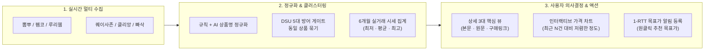

# 📚 InsightDeal 마스터 위키 (Architecture, File Catalog, Roadmap & API Reference)

> **문서 버전**: `v2.6.0-Master-Wiki`  
> **최종 업데이트**: 2026-10-27  
> **목적**: InsightDeal의 **나아갈 방향(Product Vision & Roadmap)**, **전체 파일별 역할 사전(Android · Backend · Web)**, **Anti-AI 디자인 및 UX 라이팅(말투) 원칙**, **핵심 클러스터링/시세 엔진**, **전체 44개 REST API 명세**를 한곳에서 탐색할 수 있는 프로젝트 중앙 위키입니다.

---

## 🧭 목차 (Table of Contents)

1. **[Part 1. 우리가 나아갈 방향 & 엔지니어링 로드맵 (Vision & Roadmap)](#part-1-우리가-나아갈-방향--엔지니어링-로드맵-vision--roadmap)**
2. **[Part 2. 작업별 수정 파일 5초 찾기 (Quick Action-to-File Matrix)](#part-2-작업별-수정-파일-5초-찾기-quick-action-to-file-matrix)**
3. **[Part 3. 전체 디렉토리 및 파일별 역할 백과사전 (File-by-File Catalog)](#part-3-전체-디렉토리-및-파일별-역할-백과사전-file-by-file-catalog)**
   - [3.1 Backend (`backend/`)](#31-backend-backend)
   - [3.2 Frontend Web (`frontend-web/src/app/`)](#32-frontend-web-frontend-websrcapp)
   - [3.3 Android App (`app/src/main/java/com/ddaeany0919/insightdeal/`)](#33-android-app-appsrcmainjavacomddaeany0919insightdeal)
4. **[Part 4. Anti-AI 디자인 & UX 라이팅(말투) 표준 가이드](#part-4-anti-ai-디자인--ux-라이팅말투-표준-가이드)**
5. **[Part 5. 핵심 알고리즘 & 시퀀스 명세 (DSU 클러스터링 · 가격 추이 · 1-RTT 알림)](#part-5-핵심-알고리즘--시퀀스-명세-dsu-클러스터링--가격-추이--1-rtt-알림)**
6. **[Part 6. 전체 44개 REST API 레퍼런스 사전](#part-6-전체-44개-rest-api-레퍼런스-사전)**

---

## Part 1. 우리가 나아갈 방향 & 엔지니어링 로드맵 (Vision & Roadmap)

### 1.1 제품 핵심 비전 (Product Vision)
InsightDeal은 단순히 여러 커뮤니티의 핫딜 글을 긁어모으는 수준을 넘어, **"지금 이 가격이 진짜 살 만한 가격인지 3초 안에 판단하고, 비싸다면 원하는 가격에 도달했을 때 가장 먼저 알림을 받는 실거래 기반 쇼핑 의사결정 플랫폼"**을 지향합니다.



### 1.2 절대 흔들리지 않는 5대 엔지니어링·기획 원칙 (Core Guardrails)
1. **상세 화면 3대 뼈대 집중 원칙**:
   - 외부 쇼핑몰(네이버 최저가 등) 단순 크롤링 가격 비교는 매칭 오염 리스크로 인해 배제합니다.
   - 상세 화면은 오직 **① 커뮤니티 실거래 시세 차트 + ② 핫딜 상세 본문(`contentHtml`) + ③ 원본 게시글 / 구매처 다이렉트 아웃링크(`ecommerceLink`)**에 집중합니다.
2. **Anti-AI 디자인 & 자연스러운 한국어 UX 라이팅**:
   - 유니코드 3D 이모지(`🎁`, `🎟️`, `⚡`, `📊`, `🔥`, `🔔`)를 배제하고 **단색 벡터 아이콘 + 컬러 도트(`●`) + 슬레이트 배지**만 사용합니다.
   - 번역투·개발자 용어(`실제 DB 연동`, `역대 최저가입니다`, `스마트 수집 로봇`)를 금지하고, **토스(Toss) 스타일의 간결한 해요체**(`최근 5건 중 가장 낮은 가격이에요`, `실거래 3건`, `설정한 가격 이하로 내려가면 바로 알려드려요`)를 유지합니다.
3. **네트워크 1-RTT 시퀀스 & 포트 8080 통일**:
   - 클라이언트가 연속으로 2번 API를 호출하는 Waterfall을 금지하고 단일 트랜잭션(`POST /api/wishlist/item-alert`)으로 처리합니다.
   - 로컬 및 컨테이너 백엔드 포트는 항상 **`8080`**으로 통일합니다 (`next.config.ts`, `route.ts`, `app/build.gradle`, `NetworkConfig.kt`, `PriceHistoryRepository.kt`, `NetworkModule.kt`).
4. **안드로이드 MVVM + Jetpack Compose Material 3 순수성**:
   - XML 레이아웃을 일절 사용하지 않으며, `ViewModel` 내부에 `android.content.Context` 참조를 엄격히 금지합니다.
   - 대량 리스트는 `LazyColumn` + `Paging3`를 통해 메모리와 리컴포지션을 방어합니다.
5. **웹 프론트엔드 모듈 분리 아키텍처**:
   - `page.tsx`에 인라인 컴포넌트를 쌓지 않고 `lib/types.ts`, `lib/utils.ts`, `components/*.tsx`로 엄격히 분리합니다.

### 1.3 단계별 로드맵 (Phase 1 ~ Phase 4)

| 단계 | 목표 테마 | 세부 마일스톤 | 상태 |
| :--- | :--- | :--- | :---: |
| **Phase 1** | **코어 엔진 완성 & Anti-AI UX 개편** | • 5대 하드 게이트 기반 DSU 동일 상품 클러스터링 완성<br>• 6개월 실거래 시세 차트(`PriceTrendChart` / `DealDetailScreen`) 연동<br>• 1-RTT 목표가 알림 엔드포인트(`item-alert`) 및 푸시 워커 연동<br>• 웹/앱 전수 이모지(`🎁`, `🎟️`, `⚡` 등) 제거 및 토스 스타일 말투 개편 | ✅ **완료** |
| **Phase 2** | **코드베이스 클린업 & 오프라인 캐시 강화** | • `backend/` 루트 및 `backend/scratch/`의 일회성 테스트 스크립트(`check_*.py`) 아카이빙<br>• 안드로이드 `HotDealsRemoteMediator` + Room DB 오프라인 캐싱 고도화<br>• 미사용 레거시 가격비교 모델(`FourMallComparisonSection.kt` 등) 완전 정리 | 🔜 **다음 단계** |
| **Phase 3** | **Play Store 정식 출시 & 알림 퍼널 고도화** | • Google Play Console AAB 서명 배포 및 스토어 에셋 최적화<br>• 목표가 도달 시 딥링크(`insightdeal://deal/{id}`) 즉시 이동 시퀀스 검증<br>• 키워드 알림 조건 세분화 (특정 커뮤니티/최대 가격 조건 결합) | 📅 **예정** |
| **Phase 4** | **실거래 시세 지수 & 시즌 특가 인텔리전스** | • 빅스마일데이·광군제·블랙프라이데이 시즌별 역대 최저가 비교 지수 제공<br>• 사용자 조회/북마크 기반 개인화 추천(`PersonalizationEngine.kt`) 고도화 | 📅 **장기 비전** |

---

## Part 2. 작업별 수정 파일 5초 찾기 (Quick Action-to-File Matrix)

새로운 기능을 넣거나 버그를 수정할 때 **어떤 파일을 열어야 하는지** 정리한 빠른 길잡이입니다.

| 하고 싶은 작업 (Use Case) | 백엔드 수정 파일 (`backend/`) | 웹 프론트엔드 수정 파일 (`frontend-web/`) | 안드로이드 앱 수정 파일 (`app/.../insightdeal/`) |
| :--- | :--- | :--- | :--- |
| **혜택 태그(`쿠폰적용`, `사은품` 등) 추출 규칙 수정** | [`routers/community.py`](file:///c:/Users/kth00/StudioProjects/InsightDeal/backend/routers/community.py) (`_BENEFIT_TAG_RULES`, `_extract_benefit_tags`) | [`components/DealDetailModal.tsx`](file:///c:/Users/kth00/StudioProjects/InsightDeal/frontend-web/src/app/components/DealDetailModal.tsx), [`page.tsx`](file:///c:/Users/kth00/StudioProjects/InsightDeal/frontend-web/src/app/page.tsx) | [`presentation/home/HomeScreen.kt`](file:///c:/Users/kth00/StudioProjects/InsightDeal/app/src/main/java/com/ddaeany0919/insightdeal/presentation/home/HomeScreen.kt) |
| **동일 상품 묶기(클러스터링) 정확도 튜닝** | [`routers/community.py`](file:///c:/Users/kth00/StudioProjects/InsightDeal/backend/routers/community.py) (`_cluster_deals`), [`services/aggregator_service.py`](file:///c:/Users/kth00/StudioProjects/InsightDeal/backend/services/aggregator_service.py) | [`page.tsx`](file:///c:/Users/kth00/StudioProjects/InsightDeal/frontend-web/src/app/page.tsx) (`source_sites` 배지 렌더링) | [`presentation/home/HomeScreen.kt`](file:///c:/Users/kth00/StudioProjects/InsightDeal/app/src/main/java/com/ddaeany0919/insightdeal/presentation/home/HomeScreen.kt) (`parseSources`) |
| **6개월 가격 변동 차트 UI & 문구 수정** | [`routers/community.py`](file:///c:/Users/kth00/StudioProjects/InsightDeal/backend/routers/community.py) (`get_post_price_history`) | [`components/PriceTrendChart.tsx`](file:///c:/Users/kth00/StudioProjects/InsightDeal/frontend-web/src/app/components/PriceTrendChart.tsx) | [`presentation/DealDetailScreen.kt`](file:///c:/Users/kth00/StudioProjects/InsightDeal/app/src/main/java/com/ddaeany0919/insightdeal/presentation/DealDetailScreen.kt) (`PriceHistoryInteractiveCard`) |
| **목표가 알림 등록 다이얼로그 & API 수정** | [`routers/wishlist.py`](file:///c:/Users/kth00/StudioProjects/InsightDeal/backend/routers/wishlist.py) (`create_or_update_item_alert`), [`services/push_worker.py`](file:///c:/Users/kth00/StudioProjects/InsightDeal/backend/services/push_worker.py) | [`components/WishlistDrawer.tsx`](file:///c:/Users/kth00/StudioProjects/InsightDeal/frontend-web/src/app/components/WishlistDrawer.tsx) | [`presentation/DealDetailScreen.kt`](file:///c:/Users/kth00/StudioProjects/InsightDeal/app/src/main/java/com/ddaeany0919/insightdeal/presentation/DealDetailScreen.kt) (`TargetPriceSetupDialog`), [`DealDetailViewModel.kt`](file:///c:/Users/kth00/StudioProjects/InsightDeal/app/src/main/java/com/ddaeany0919/insightdeal/presentation/DealDetailViewModel.kt) |
| **새로운 커뮤니티 크롤러 추가/수정** | [`scrapers/`](file:///c:/Users/kth00/StudioProjects/InsightDeal/backend/scrapers) 하위 스크래퍼 + [`scheduler/main.py`](file:///c:/Users/kth00/StudioProjects/InsightDeal/backend/scheduler/main.py) | [`lib/utils.ts`](file:///c:/Users/kth00/StudioProjects/InsightDeal/frontend-web/src/app/lib/utils.ts) (`SITE_MAP` 색상/이름 추가) | [`presentation/DealDetailScreen.kt`](file:///c:/Users/kth00/StudioProjects/InsightDeal/app/src/main/java/com/ddaeany0919/insightdeal/presentation/DealDetailScreen.kt), [`HomeScreen.kt`](file:///c:/Users/kth00/StudioProjects/InsightDeal/app/src/main/java/com/ddaeany0919/insightdeal/presentation/home/HomeScreen.kt) |
| **키워드 푸시 알림 설정 수정** | [`routers/users.py`](file:///c:/Users/kth00/StudioProjects/InsightDeal/backend/routers/users.py), [`routers/push.py`](file:///c:/Users/kth00/StudioProjects/InsightDeal/backend/routers/push.py) | [`settings/notifications/page.tsx`](file:///c:/Users/kth00/StudioProjects/InsightDeal/frontend-web/src/app/settings/notifications/page.tsx) | [`presentation/KeywordManagerScreen.kt`](file:///c:/Users/kth00/StudioProjects/InsightDeal/app/src/main/java/com/ddaeany0919/insightdeal/presentation/KeywordManagerScreen.kt), [`KeywordManagerViewModel.kt`](file:///c:/Users/kth00/StudioProjects/InsightDeal/app/src/main/java/com/ddaeany0919/insightdeal/presentation/KeywordManagerViewModel.kt) |
| **로컬/서버 포트(8080) 및 네트워크 타임아웃 변경** | [`main.py`](file:///c:/Users/kth00/StudioProjects/InsightDeal/backend/main.py) | [`next.config.ts`](file:///c:/Users/kth00/StudioProjects/InsightDeal/frontend-web/next.config.ts), [`api/push-register/route.ts`](file:///c:/Users/kth00/StudioProjects/InsightDeal/frontend-web/src/app/api/push-register/route.ts) | [`app/build.gradle`](file:///c:/Users/kth00/StudioProjects/InsightDeal/app/build.gradle), [`NetworkConfig.kt`](file:///c:/Users/kth00/StudioProjects/InsightDeal/app/src/main/java/com/ddaeany0919/insightdeal/data/network/NetworkConfig.kt), [`NetworkModule.kt`](file:///c:/Users/kth00/StudioProjects/InsightDeal/app/src/main/java/com/ddaeany0919/insightdeal/network/NetworkModule.kt), [`PriceHistoryRepository.kt`](file:///c:/Users/kth00/StudioProjects/InsightDeal/app/src/main/java/com/ddaeany0919/insightdeal/data/PriceHistoryRepository.kt) |

---

## Part 3. 전체 디렉토리 및 파일별 역할 백과사전 (File-by-File Catalog)

### 3.1 Backend (`backend/`)
FastAPI + SQLAlchemy(Async/Sync) + BeautifulSoup4/Cloudscraper 기반의 백엔드 서버입니다.

#### 📌 엔트리포인트 & 코어 (`backend/`, `backend/core/`)
| 파일 경로 | 핵심 역할 및 주요 함수/클래스 |
| :--- | :--- |
| [`backend/main.py`](file:///c:/Users/kth00/StudioProjects/InsightDeal/backend/main.py) | FastAPI 앱 초기화, CORS 설정, 11개 라우터 마운트, 백그라운드 스케줄러(`scheduler/main.py`) 기동 및 `/api/image-proxy` 제공 |
| [`backend/core/config.py`](file:///c:/Users/kth00/StudioProjects/InsightDeal/backend/core/config.py) | 환경변수(`.env`), DB URL, Gemini/OpenAI API 키, 포트(`8080`) 설정 관리 |
| [`backend/core/ai_parser.py`](file:///c:/Users/kth00/StudioProjects/InsightDeal/backend/core/ai_parser.py) | LLM을 활용해 복잡한 게시글 제목에서 브랜드, 모델명, 가격, 배송비를 구조화 추출 |
| [`backend/core/rule_parser.py`](file:///c:/Users/kth00/StudioProjects/InsightDeal/backend/core/rule_parser.py) | 정규식 기반으로 제목에서 쇼핑몰(`[쿠팡]`, `(지마켓)`), 가격(`15,900원`), 배송비(`무료`, `무배`)를 1차 고속 파싱 |
| [`backend/core/product_analyzer.py`](file:///c:/Users/kth00/StudioProjects/InsightDeal/backend/core/product_analyzer.py) | 상품 가성비 점수(0~100) 및 시세 대비 장단점 분석 엔진 |
| [`backend/core/url_utils.py`](file:///c:/Users/kth00/StudioProjects/InsightDeal/backend/core/url_utils.py) | 단축 URL 해제, 트래킹 파라미터 제거, 쇼핑몰 도메인 정규화 유틸리티 |
| [`backend/core/notifications.py`](file:///c:/Users/kth00/StudioProjects/InsightDeal/backend/core/notifications.py) | Firebase Admin SDK 기반 FCM 푸시 메시지 발송 래퍼 |

#### 📌 API 라우터 (`backend/routers/`, `backend/api/`)
| 파일 경로 | 프리픽스 | 핵심 역할 |
| :--- | :--- | :--- |
| [`backend/routers/community.py`](file:///c:/Users/kth00/StudioProjects/InsightDeal/backend/routers/community.py) | `/api/community` | **[핵심]** 핫딜 목록 조회(`get_posts`), DSU 클러스터링(`_cluster_deals`), 혜택 태그 추출(`_extract_benefit_tags`), 6개월 실거래 가격 히스토리(`get_post_price_history`), 투표(`vote_post`) |
| [`backend/routers/wishlist.py`](file:///c:/Users/kth00/StudioProjects/InsightDeal/backend/routers/wishlist.py) | `/api/wishlist` | **[핵심]** 1-RTT 원스톱 목표가 알림 등록(`POST /item-alert`), 위시리스트 CRUD, 가격 기록 추가 |
| [`backend/routers/users.py`](file:///c:/Users/kth00/StudioProjects/InsightDeal/backend/routers/users.py) | `/api/users` | 디바이스 UUID 기반 키워드 알림(`UserKeyword`) 조회·등록·삭제 및 활동 요약(`summary`) |
| [`backend/routers/push.py`](file:///c:/Users/kth00/StudioProjects/InsightDeal/backend/routers/push.py) | `/api/push` | 앱/웹 FCM 디바이스 토큰 등록(`register_push_token`) |
| [`backend/routers/auth.py`](file:///c:/Users/kth00/StudioProjects/InsightDeal/backend/routers/auth.py) | `/api/auth` | 이메일 회원가입, JWT 로그인 토큰 발급, 내 프로필 조회 |
| [`backend/routers/product.py`](file:///c:/Users/kth00/StudioProjects/InsightDeal/backend/routers/product.py) | `/api` | 상품 URL 기반 정보 추출 및 AI 살까말까 데모 판독(`/api/ai/analyze-demo`) |
| [`backend/routers/coupang.py`](file:///c:/Users/kth00/StudioProjects/InsightDeal/backend/routers/coupang.py) | `/api/coupang` | 쿠팡 단일 상품 추적 등록/삭제/가격 히스토리 조회 |
| [`backend/routers/admin.py`](file:///c:/Users/kth00/StudioProjects/InsightDeal/backend/routers/admin.py) | `/api/admin` | 서버 캐시 퍼지, 수동 스크래핑 트리거, 통계 모니터링 |
| [`backend/routers/health.py`](file:///c:/Users/kth00/StudioProjects/InsightDeal/backend/routers/health.py) | `/api/health` | 서버 생존 확인, DB 레이턴시, 메모리/디스크 상태 체크 |
| [`backend/api/history.py`](file:///c:/Users/kth00/StudioProjects/InsightDeal/backend/api/history.py) | `/api/history` | 상품 키워드 기반 외부/내부 가격 히스토리 조회 |

#### 📌 비즈니스 서비스 & 정규화 (`backend/services/`)
| 파일 경로 | 핵심 역할 |
| :--- | :--- |
| [`backend/services/aggregator_service.py`](file:///c:/Users/kth00/StudioProjects/InsightDeal/backend/services/aggregator_service.py) | **[핵심]** 각 스크래퍼가 수집한 게시글을 DB(`DealItem`)에 저장하고, 동일 상품 그룹(`ProductCatalog`) 매칭 및 `push_worker` 트리거 수행 |
| [`backend/services/push_worker.py`](file:///c:/Users/kth00/StudioProjects/InsightDeal/backend/services/push_worker.py) | **[핵심]** 신규 딜 유입 시 ① 키워드 알림(`UserKeyword`) 매칭 및 ② 위시리스트 목표가(`WishlistPriceAlert`) 이하 도달 여부를 검사하여 FCM 발송 |
| [`backend/services/ai_product_name_service.py`](file:///c:/Users/kth00/StudioProjects/InsightDeal/backend/services/ai_product_name_service.py) | 지저분한 게시글 제목에서 순수 정규화 상품명(`clean_name`)을 추출 |
| [`backend/services/normalizer/regex_normalizer.py`](file:///c:/Users/kth00/StudioProjects/InsightDeal/backend/services/normalizer/regex_normalizer.py) | 1단계 정규식 상품명 정제기 (특수문자, 배송비 꼬리표, 가격 괄호 제거) |
| [`backend/services/normalizer/llm_normalizer.py`](file:///c:/Users/kth00/StudioProjects/InsightDeal/backend/services/normalizer/llm_normalizer.py) | 2단계 LLM 기반 상품명/모델번호 정밀 정규화기 |
| [`backend/services/wishlist_service.py`](file:///c:/Users/kth00/StudioProjects/InsightDeal/backend/services/wishlist_service.py) | 위시리스트 아이템 생성, 목표가 비교, 알림 상태 갱신 비즈니스 로직 |

#### 📌 멀티 커뮤니티 스크래퍼 (`backend/scrapers/`)
| 파일 경로 | 대상 커뮤니티 | 특징 |
| :--- | :--- | :--- |
| [`backend/scrapers/base_scraper.py`](file:///c:/Users/kth00/StudioProjects/InsightDeal/backend/scrapers/base_scraper.py) | 공통 추상 클래스 | User-Agent 로테이션, 재시도, 공통 스키마(`ScrapedDeal`) 변환 |
| [`backend/scrapers/ppomppu_scraper.py`](file:///c:/Users/kth00/StudioProjects/InsightDeal/backend/scrapers/ppomppu_scraper.py) / [`ppomppu_overseas_scraper.py`](file:///c:/Users/kth00/StudioProjects/InsightDeal/backend/scrapers/ppomppu_overseas_scraper.py) | 뽐뿌 (국내/해외) | EUC-KR/UTF-8 인코딩 안전 디코딩, 품절선(`<strike>`) 감지 |
| [`backend/scrapers/fmkorea_scraper.py`](file:///c:/Users/kth00/StudioProjects/InsightDeal/backend/scrapers/fmkorea_scraper.py) / [`fmkorea_trending_scraper.py`](file:///c:/Users/kth00/StudioProjects/InsightDeal/backend/scrapers/fmkorea_trending_scraper.py) | 에프엠코리아 | `curl_cffi` 브라우저 TLS 핑거프린트 위장으로 Cloudflare/안티봇 우회 |
| [`backend/scrapers/quasarzone_scraper.py`](file:///c:/Users/kth00/StudioProjects/InsightDeal/backend/scrapers/quasarzone_scraper.py) | 퀘이사존 지름/할인정보 | IT/하드웨어 특화 파싱, 진행중/종료 상태 및 원화/달러 가격 파싱 |
| [`backend/scrapers/ruliweb_scraper.py`](file:///c:/Users/kth00/StudioProjects/InsightDeal/backend/scrapers/ruliweb_scraper.py) | 루리웹 핫딜게시판 | 루리웹 데스크톱/모바일 본문 링크 및 썸네일 추출 |
| [`backend/scrapers/clien_scraper.py`](file:///c:/Users/kth00/StudioProjects/InsightDeal/backend/scrapers/clien_scraper.py) | 클리앙 알뜰구매 | 구매 링크 아웃바운드 추출 및 품절 태그 감지 |
| [`backend/scrapers/bbasak_domestic_scraper.py`](file:///c:/Users/kth00/StudioProjects/InsightDeal/backend/scrapers/bbasak_domestic_scraper.py) / [`bbasak_overseas_scraper.py`](file:///c:/Users/kth00/StudioProjects/InsightDeal/backend/scrapers/bbasak_overseas_scraper.py) | 빠삭 (국내/해외) | 빠삭 특가 게시판 파싱 (`bbasak_base_scraper.py` 상속) |
| [`backend/scrapers/alippomppu_scraper.py`](file:///c:/Users/kth00/StudioProjects/InsightDeal/backend/scrapers/alippomppu_scraper.py) | 알리뽐뿌 | 알리익스프레스 직구/코인딜 특화 수집 |

#### 📌 데이터베이스 모델 (`backend/database/`, `backend/models/`)
| 파일 경로 | 핵심 테이블/모델 |
| :--- | :--- |
| [`backend/database/session.py`](file:///c:/Users/kth00/StudioProjects/InsightDeal/backend/database/session.py) | SQLite / PostgreSQL 커넥션 풀 및 `get_db()` 의존성 주입 |
| [`backend/database/models.py`](file:///c:/Users/kth00/StudioProjects/InsightDeal/backend/database/models.py) | `DealItem` (핫딜 게시글), `ProductCatalog` (정규화 상품 마스터), `PriceTracking` (시세 이력), `UserKeyword` (키워드 알림) |
| [`backend/models/wishlist_models.py`](file:///c:/Users/kth00/StudioProjects/InsightDeal/backend/models/wishlist_models.py) | `WishlistItem` (관심상품), `WishlistPriceHistory` (관심상품 가격 이력), `WishlistPriceAlert` (목표가 알림 조건) |

---

### 3.2 Frontend Web (`frontend-web/src/app/`)
Next.js 16 (App Router) + React 19 + Recharts + Lucide Icons 기반의 반응형 웹 애플리케이션입니다.

| 파일 경로 | 핵심 역할 및 아키텍처 포인트 |
| :--- | :--- |
| [`frontend-web/src/app/page.tsx`](file:///c:/Users/kth00/StudioProjects/InsightDeal/frontend-web/src/app/page.tsx) | 메인 핫딜 피드 화면. 카테고리/커뮤니티 탭 필터링, 무한 스크롤, 검색바, 북마크(찜) 토글, 모바일 하단 탭바 관리 |
| [`frontend-web/src/app/layout.tsx`](file:///c:/Users/kth00/StudioProjects/InsightDeal/frontend-web/src/app/layout.tsx) | 전역 메타데이터(SEO/OG), Pretendard 웹폰트, PWA 매니페스트 바인딩 |
| [`frontend-web/src/app/lib/types.ts`](file:///c:/Users/kth00/StudioProjects/InsightDeal/frontend-web/src/app/lib/types.ts) | `Deal`, `PriceHistoryPoint`, `PriceHistoryResponse`, `AIDemoResult` 등 공유 TypeScript 인터페이스 정의 |
| [`frontend-web/src/app/lib/utils.ts`](file:///c:/Users/kth00/StudioProjects/InsightDeal/frontend-web/src/app/lib/utils.ts) | `SITE_MAP`(커뮤니티별 브랜드 컬러/이름), `formatPrice`, `categorizeDeal`, `getProxyImageUrl`(CORS 우회 이미지 프록시) |
| [`frontend-web/src/app/components/DealDetailModal.tsx`](file:///c:/Users/kth00/StudioProjects/InsightDeal/frontend-web/src/app/components/DealDetailModal.tsx) | **[핵심]** 핫딜 상세 모달. 혜택 태그(이모지 제거 슬레이트 칩), 살까/말까 투표, 본문 HTML 렌더링, `<PriceTrendChart />`, 원본 글/구매처 아웃링크 버튼 |
| [`frontend-web/src/app/components/PriceTrendChart.tsx`](file:///c:/Users/kth00/StudioProjects/InsightDeal/frontend-web/src/app/components/PriceTrendChart.tsx) | **[핵심]** 7일/1개월/3개월/6개월 실거래 가격 변동 AreaChart. 역대 최저가(에메랄드 도트), 기간 최고가(앰버 도트), 평균가 점선 및 토스 스타일 가격 인사이트 배지 렌더링 |
| [`frontend-web/src/app/components/WishlistDrawer.tsx`](file:///c:/Users/kth00/StudioProjects/InsightDeal/frontend-web/src/app/components/WishlistDrawer.tsx) | 우측 슬라이드 찜 목록 & 목표가 알림 관리 드로어 (`POST /api/wishlist/item-alert` 연동) |
| [`frontend-web/src/app/components/NotificationDrawer.tsx`](file:///c:/Users/kth00/StudioProjects/InsightDeal/frontend-web/src/app/components/NotificationDrawer.tsx) | 실시간 키워드/목표가 알림 수신 내역 드로어 |
| [`frontend-web/src/app/components/AIDetector.tsx`](file:///c:/Users/kth00/StudioProjects/InsightDeal/frontend-web/src/app/components/AIDetector.tsx) | 사용자가 상품명+가격을 입력하면 즉시 가성비 점수를 판독해주는 인터랙티브 섹션 |
| [`frontend-web/src/app/settings/notifications/page.tsx`](file:///c:/Users/kth00/StudioProjects/InsightDeal/frontend-web/src/app/settings/notifications/page.tsx) | 웹 키워드 알림 등록/삭제 전용 설정 페이지 |
| [`frontend-web/src/app/api/push-register/route.ts`](file:///c:/Users/kth00/StudioProjects/InsightDeal/frontend-web/src/app/api/push-register/route.ts) | 웹 푸시 토큰을 백엔드(`http://127.0.0.1:8080/api/push/register`)로 전달하는 Next.js Route Handler |

---

### 3.3 Android App (`app/src/main/java/com/ddaeany0919/insightdeal/`)
100% Jetpack Compose (Material 3) + Coroutines/StateFlow + Room + Paging3 + Retrofit2 기반의 네이티브 안드로이드 앱입니다.

#### 📌 앱 엔트리 & 코어 인프라 (`core/`)
| 파일 경로 | 핵심 역할 |
| :--- | :--- |
| [`InsightDealApplication.kt`](file:///c:/Users/kth00/StudioProjects/InsightDeal/app/src/main/java/com/ddaeany0919/insightdeal/InsightDealApplication.kt) | 앱 프로세스 초기화, 알림 채널 생성, 백그라운드 가격 체크 스케줄러 등록 |
| [`MainActivity.kt`](file:///c:/Users/kth00/StudioProjects/InsightDeal/app/src/main/java/com/ddaeany0919/insightdeal/MainActivity.kt) | 단일 Activity 엔트리포인트, 딥링크 수신 처리, 하단 네비게이션 탭(홈 · 검색 · 찜/알림 · 커뮤니티 · 내정보) 호스팅 |
| [`core/NotificationService.kt`](file:///c:/Users/kth00/StudioProjects/InsightDeal/app/src/main/java/com/ddaeany0919/insightdeal/core/NotificationService.kt) | FirebaseMessagingService 구현체. 푸시 알림 수신 시 로컬 알림 생성 및 `NotificationHistoryManager` 기록 |
| [`core/network/NetworkMonitor.kt`](file:///c:/Users/kth00/StudioProjects/InsightDeal/app/src/main/java/com/ddaeany0919/insightdeal/core/network/NetworkMonitor.kt) | ConnectivityManager 기반 실시간 온라인/오프라인 상태 `StateFlow` 제공 |
| [`core/security/EncryptedPrefsManager.kt`](file:///c:/Users/kth00/StudioProjects/InsightDeal/app/src/main/java/com/ddaeany0919/insightdeal/core/security/EncryptedPrefsManager.kt) | Android Keystore 기반 암호화 SharedPreferences (JWT 토큰, 디바이스 UUID 안전 보관) |

#### 📌 데이터 레이어 & 네트워크 (`data/`, `network/`, `local/db/`)
| 파일 경로 | 핵심 역할 |
| :--- | :--- |
| [`network/NetworkModule.kt`](file:///c:/Users/kth00/StudioProjects/InsightDeal/app/src/main/java/com/ddaeany0919/insightdeal/network/NetworkModule.kt) | OkHttp + Retrofit 싱글톤 팩토리 (포트 `8080` 기본 바인딩, Gzip/로깅 인터셉터) |
| [`network/ApiService.kt`](file:///c:/Users/kth00/StudioProjects/InsightDeal/app/src/main/java/com/ddaeany0919/insightdeal/network/ApiService.kt) | 커뮤니티 핫딜 조회, 상세 조회, 가격 히스토리(`getPostPriceHistory`), 투표, 키워드 알림 Retrofit 인터페이스 |
| [`data/network/WishlistApiService.kt`](file:///c:/Users/kth00/StudioProjects/InsightDeal/app/src/main/java/com/ddaeany0919/insightdeal/data/network/WishlistApiService.kt) | 1-RTT 목표가 알림 등록(`createOrUpdateItemAlert`) 및 위시리스트 동기화 Retrofit 인터페이스 |
| [`data/PriceHistoryRepository.kt`](file:///c:/Users/kth00/StudioProjects/InsightDeal/app/src/main/java/com/ddaeany0919/insightdeal/data/PriceHistoryRepository.kt) | 상세 화면 진입 시 6개월 실거래 가격 히스토리 조회 및 메모리 캐싱 |
| [`data/CommunityRepository.kt`](file:///c:/Users/kth00/StudioProjects/InsightDeal/app/src/main/java/com/ddaeany0919/insightdeal/data/CommunityRepository.kt) | 커뮤니티 게시글 목록/상세 조회 및 로컬 폴백 처리 |
| [`local/db/AppDatabase.kt`](file:///c:/Users/kth00/StudioProjects/InsightDeal/app/src/main/java/com/ddaeany0919/insightdeal/local/db/AppDatabase.kt) | Room 데이터베이스 (`DealEntity`, `DealRemoteKeysEntity`, `WishlistEntity`, `KeywordEntity` 통합 관리) |

#### 📌 프레젠테이션 레이어 (`presentation/`)
| 파일 경로 | 핵심 역할 |
| :--- | :--- |
| [`presentation/home/HomeScreen.kt`](file:///c:/Users/kth00/StudioProjects/InsightDeal/app/src/main/java/com/ddaeany0919/insightdeal/presentation/home/HomeScreen.kt) & [`HomeViewModel.kt`](file:///c:/Users/kth00/StudioProjects/InsightDeal/app/src/main/java/com/ddaeany0919/insightdeal/presentation/home/HomeViewModel.kt) | **[핵심]** 메인 핫딜 피드. `LazyColumn` + `Paging3`(`HotDealsPagingSource`) 기반 무한 스크롤, 멀티 출처 배지(`펨코`, `퀘이사존` 등), 카테고리 탭 필터링 |
| [`presentation/DealDetailScreen.kt`](file:///c:/Users/kth00/StudioProjects/InsightDeal/app/src/main/java/com/ddaeany0919/insightdeal/presentation/DealDetailScreen.kt) & [`DealDetailViewModel.kt`](file:///c:/Users/kth00/StudioProjects/InsightDeal/app/src/main/java/com/ddaeany0919/insightdeal/presentation/DealDetailViewModel.kt) | **[핵심]** 핫딜 상세 화면. ① `PriceHistoryInteractiveCard`(7일~6개월 드래그 스크러빙 Canvas 차트) ② `PriceAlertRegistrationButton` & `TargetPriceSetupDialog`(원클릭 추천 목표가 다이얼로그) ③ 본문 및 원본/구매처 아웃링크 버튼 |
| [`presentation/wishlist/WishlistScreen.kt`](file:///c:/Users/kth00/StudioProjects/InsightDeal/app/src/main/java/com/ddaeany0919/insightdeal/presentation/wishlist/WishlistScreen.kt) & [`WishlistViewModel.kt`](file:///c:/Users/kth00/StudioProjects/InsightDeal/app/src/main/java/com/ddaeany0919/insightdeal/presentation/wishlist/WishlistViewModel.kt) | 등록된 목표가 알림 및 관심상품 대시보드, 스와이프 삭제, 알림 토글 |
| [`presentation/KeywordManagerScreen.kt`](file:///c:/Users/kth00/StudioProjects/InsightDeal/app/src/main/java/com/ddaeany0919/insightdeal/presentation/KeywordManagerScreen.kt) & [`KeywordManagerViewModel.kt`](file:///c:/Users/kth00/StudioProjects/InsightDeal/app/src/main/java/com/ddaeany0919/insightdeal/presentation/KeywordManagerViewModel.kt) | 푸시 알림 키워드 등록/삭제 화면 (서버 `UserKeyword` + 로컬 Room 동기화) |
| [`presentation/search/AdvancedSearchScreen.kt`](file:///c:/Users/kth00/StudioProjects/InsightDeal/app/src/main/java/com/ddaeany0919/insightdeal/presentation/search/AdvancedSearchScreen.kt) & [`AdvancedSearchViewModel.kt`](file:///c:/Users/kth00/StudioProjects/InsightDeal/app/src/main/java/com/ddaeany0919/insightdeal/presentation/search/AdvancedSearchViewModel.kt) | 최근 검색어, 인기 검색어, 가격대/할인율/커뮤니티 복합 조건 검색 화면 |
| [`presentation/webview/DealWebViewScreen.kt`](file:///c:/Users/kth00/StudioProjects/InsightDeal/app/src/main/java/com/ddaeany0919/insightdeal/presentation/webview/DealWebViewScreen.kt) | 인앱 브라우저 및 외부 쇼핑몰 앱 스킴(`coupang://`, `intent://`) 안전 실행 |

---

## Part 4. Anti-AI 디자인 & UX 라이팅(말투) 표준 가이드

### 4.1 왜 선물(`🎁`)·쿠폰(`🎟️`) 이모지와 번역투 문장을 제거했는가?
LLM이 자동 생성한 UI의 가장 흔한 특징은 **① 모든 태그 앞에 유니코드 컬러 이모지(`🎁 사은품증정`, `🎟️ 쿠폰적용`, `⚡ 선착순특가`, `📊 평균가`)를 붙이는 것**과 **② 내부 구현 용어나 과장된 번역투 문장(`실제 DB 연동 (3건)`, `현재 가격이 최근 5건 핫딜 중 역대 최저가입니다!`, `현 디바이스 데이터베이스의 유사 품종 평균보다 압도적으로 저렴한 지표를 갖추고 있습니다`)을 사용자에게 그대로 노출하는 것**입니다.

InsightDeal은 프로덕션 핀테크·커머스 앱(토스, 크림, 무신사) 수준의 정제된 인상을 주기 위해 다음 규칙을 전수 적용했습니다.

### 4.2 이모지 제거 & UX 라이팅(말투) Before / After 대조표

| 영역 | ❌ 기존 (AI 느낌 나는 이모지 & 딱딱한 말투) | ✅ 개편 후 (Anti-AI 벡터 도트 & 토스 스타일 해요체) |
| :--- | :--- | :--- |
| **혜택 태그 (`community.py`, `DealDetailModal.tsx`)** | `🎟️ 쿠폰적용`, `🎁 사은품증정`, `⚡ 선착순특가`, `💳 삼성카드`, `🚀 로켓배송`, `✈️ 해외직구` | `쿠폰적용`, `사은품`, `타임특가`, `삼성카드`, `로켓배송`, `해외직구` (이모지 전면 제거 + 무채색 슬레이트 배지) |
| **차트 데이터 출처 배지 (`PriceTrendChart.tsx`)** | `● 실제 DB 연동 (3건)` / `● AI 예측 모델` | `● 실거래 3건` / `● 예상 추이` |
| **차트 하단 시세 요약 문구** | `현재 가격이 최근 5건 핫딜 중 역대 최저가입니다! (평균 대비 22% 저렴)` | `● 최근 5건 중 가장 낮은 가격이에요 · 평균보다 22% 저렴` |
| **상세 시세 인사이트 (`DealDetailScreen.kt`)** | `🤖 AI 구매 가이드` / `현 디바이스 데이터베이스의 유사 품종 평균보다 압도적으로 저렴한 지표를 갖추고 있습니다.` | `시세 요약` / `최근 올라온 같은 상품 평균가보다 확실히 낮은 가격이에요.` |
| **목표가 알림 다이얼로그 (`DealDetailScreen.kt`)** | `원클릭 추천 목표가` / `[⚡ 역대 최저가 126,700원]` / `[📊 평균가 133,115원]` / `현재가 대비 6,335원 (5%) 하락 시 즉시 푸시 알림 발송` | `추천 목표가` / `[● 역대 최저 126,700원]` / `[● 평균가 133,115원]` / `현재가보다 6,335원 (5%) 낮을 때 알림을 보내드려요` |
| **메인 배너 (`page.tsx`)** | `위시리스트 키워드 알림 설정하기` / `🔔 알림 설정` | `찾는 상품이 올라오면 가장 먼저 알려드려요` / `키워드 알림 설정하기` / `설정 ›` |

### 4.3 최신 UI 캡처 화면 (이모지 제거 & UX 말투 반영 완료본)

````carousel

<!-- slide -->

<!-- slide -->

````

---

## Part 5. 핵심 알고리즘 & 시퀀스 명세 (DSU 클러스터링 · 가격 추이 · 1-RTT 알림)

### 5.1 DSU(Disjoint Set Union) 5대 하드 게이트 클러스터링
`backend/routers/community.py`의 `_cluster_deals()`와 `backend/services/aggregator_service.py`는 서로 다른 커뮤니티에 올라온 게시글이 **진짜 동일한 상품인지** 판별하기 위해 아래 5단계 하드 게이트를 통과할 때만 하나의 클러스터로 병합합니다.

1. **Gate 1 — 모델 코드 하드 게이트 (`model_codes`)**:
   - 영문+숫자 조합 모델명(예: `WIZ040`, `S26`, `RTX5080`, `Q9000`)이 양쪽 게시글에 모두 존재할 때, 교집합이 비어 있으면 즉시 병합을 거부합니다.
2. **Gate 2 — 사양·수량·용량 토큰 게이트 (`spec_tokens`)**:
   - 정규화 토큰(`500ml`, `3팩`, `32gb`, `25w`)이 양쪽 모두 존재할 때 정확히 일치하지 않으면(`spec_i != spec_j`) 다른 옵션 상품으로 판정하여 분리합니다.
3. **Gate 3 — 플러스(`+`) 번들 구성 게이트 (`plus_count`)**:
   - 단품(`본품`)과 세트(`본품 + 사은품 추가 구성`)가 섞이지 않도록 `+` 결합 개수가 다르면 분리합니다.
4. **Gate 4 — 가격 편차 35% 캡 게이트 (`price_ratio`)**:
   - 두 게시글의 가격 비율 $\frac{\min(P_i, P_j)}{\max(P_i, P_j)} < 0.65$ 인 경우(35% 초과 차이), 본품과 액세서리/케이스가 잘못 묶이는 것을 차단합니다.
5. **Gate 5 — 가중 Jaccard 유사도 게이트 (`sim >= 0.58`)**:
   - 숫자 포함 토큰에 가중치 `2.0`, 일반 단어에 `1.0`을 부여한 가중 Jaccard 유사도가 임계치 이상일 때만 최종 병합합니다.

---

## Part 6. 전체 44개 REST API 레퍼런스 사전

> **기본 로컬 서버 주소 (Base URL)**: `http://localhost:8080` (Android 에뮬레이터: `http://10.0.2.2:8080`)

### 6.1 커뮤니티 핫딜 & 실거래 시세 API (`backend/routers/community.py`)
| # | Method | Path | Query / Body 파라미터 | 설명 |
| :-: | :---: | :--- | :--- | :--- |
| 1 | `GET` | `/api/community/posts` | `source`, `category`, `search`, `skip`, `limit`, `hide_ended` | DSU 클러스터링이 적용된 통합 핫딜 목록 조회 (`source_sites`, `tags` 포함) |
| 2 | `GET` | `/api/community/posts/featured` | - | 조회수·추천수 가중치 기반 인기 핫딜 Top 5 조회 |
| 3 | `GET` | `/api/community/posts/popular-keywords` | - | 최근 48시간 내 가장 많이 등장한 인기 브랜드/상품 키워드 Top 10 |
| 4 | `GET` | `/api/community/posts/{post_id}` | `post_id` (Path) | 단일 핫딜 상세 정보 조회 (`content_html`, `ecommerce_link` 포함) |
| 5 | `GET` | `/api/community/posts/{post_id}/price-history` | `period` (`7d` \| `1m` \| `3m` \| `6m`) | **[핵심]** 동일 상품 클러스터 및 과거 6개월 실거래 시세(`lowest_price`, `average_price`, `highest_price`, `history[]`) 조회 |
| 6 | `POST` | `/api/community/posts/{post_id}/vote` | Body: `{"vote_type": "up" \| "down"}` | 핫딜 상세 '살까(추천) / 말까(비추천)' 실시간 투표 |
| 7 | `GET` | `/api/community/posts/{post_id}/comments` | `post_id` (Path) | 게시글 댓글 목록 조회 |

### 6.2 위시리스트 & 1-RTT 목표가 알림 API (`backend/routers/wishlist.py`)
| # | Method | Path | Header / Body 파라미터 | 설명 |
| :-: | :---: | :--- | :--- | :--- |
| 8 | `POST` | `/api/wishlist/item-alert` | Header: `X-User-Key`<br>Body: `ItemAlertCreateRequest` (`title`, `current_price`, `target_price`, `mall_name`, `product_url`, `image_url`) | **[핵심 1-RTT]** 핫딜 상세 화면에서 원스톱으로 관심상품 생성 + 초기 가격 기록 + 목표가 알림(`WishlistPriceAlert`)을 단일 트랜잭션으로 등록/갱신 |
| 9 | `POST` | `/api/wishlist/items` | Header: `X-User-Key`, Body: `WishlistItemCreate` | 위시리스트 아이템 단독 생성 |
| 10 | `GET` | `/api/wishlist/items` | Header: `X-User-Key`, Query: `page`, `size` | 내 위시리스트 및 목표가 알림 목록 조회 |
| 11 | `GET` | `/api/wishlist/items/{item_id}` | Header: `X-User-Key` | 특정 위시리스트 아이템 상세 및 가격 히스토리 조회 |
| 12 | `PUT` | `/api/wishlist/items/{item_id}` | Header: `X-User-Key`, Body: `WishlistItemUpdate` | 위시리스트 아이템 목표가/메모 수정 |
| 13 | `DELETE` | `/api/wishlist/items/{item_id}` | Header: `X-User-Key` | 위시리스트 아이템 및 연결된 알림 삭제 |
| 14 | `POST` | `/api/wishlist/items/{item_id}/prices` | Header: `X-User-Key`, Body: `PriceHistoryCreate` | 특정 아이템에 수동/자동 가격 포인트 추가 |
| 15 | `GET` | `/api/wishlist/items/{item_id}/prices` | Query: `days` (기본 30) | 특정 아이템의 일별 가격 변동 내역 조회 |
| 16 | `POST` | `/api/wishlist/items/{item_id}/alerts` | Header: `X-User-Key`, Body: `PriceAlertCreate` | 기존 아이템에 추가 가격 알림 조건 설정 |
| 17 | `GET` | `/api/wishlist/alerts` | Header: `X-User-Key` | 활성화된 전체 목표가 알림 목록 조회 |
| 18 | `GET` | `/api/wishlist/stats` | Header: `X-User-Key` | 위시리스트 통계 요약 (목표가 도달 건수, 평균 절감액 등) |

### 6.3 사용자 키워드 알림 & 푸시 API (`backend/routers/users.py`, `push.py`, `auth.py`)
| # | Method | Path | 파라미터 | 설명 |
| :-: | :---: | :--- | :--- | :--- |
| 19 | `GET` | `/api/users/{device_uuid}/keywords` | `device_uuid` (Path) | 기기에 등록된 알림 키워드 목록 조회 |
| 20 | `POST` | `/api/users/{device_uuid}/keywords` | Body: `{"keyword": "맥북"}` | 새 알림 키워드 등록 (중복 방지 포함) |
| 21 | `DELETE` | `/api/users/{device_uuid}/keywords/{keyword}` | `device_uuid`, `keyword` (Path) | 등록된 알림 키워드 삭제 |
| 22 | `GET` | `/api/users/{device_uuid}/summary` | `device_uuid` (Path) | 마이페이지용 내 키워드 수/알림 요약 조회 |
| 23 | `POST` | `/api/push/register` | Body: `{"token": "...", "device_type": "android" \| "web"}` | FCM 푸시 토큰 등록 및 갱신 |
| 24 | `POST` | `/api/auth/register` | Body: `UserCreate` | 이메일 기반 회원가입 |
| 25 | `POST` | `/api/auth/login` | Form: `username`, `password` | JWT 액세스 토큰 발급 |
| 26 | `GET` | `/api/auth/me` | Header: `Authorization: Bearer <token>` | 현재 로그인된 사용자 정보 조회 |

### 6.4 상품 분석, 쿠팡 추적, 헬스체크 & 어드민 API (`product.py`, `coupang.py`, `health.py`, `admin.py`, `history.py`, `main.py`)
| # | Method | Path | 설명 |
| :-: | :---: | :--- | :--- |
| 27 | `POST` | `/api/ai/analyze-demo` | 상품명+가격 입력 시 시세 대비 가성비 점수(0~100) 및 코멘트 즉시 반환 |
| 28 | `POST` | `/api/analyze-product` | 쇼핑몰 상품 URL 기반 메타데이터 및 가격 분석 |
| 29 | `GET` | `/api/supported-domains` | URL 분석을 지원하는 쇼핑몰 도메인 목록 반환 |
| 30 | `GET` | `/api/history` | 키워드 기반 가격 히스토리 조회 (`api/history.py`) |
| 31 | `GET` | `/api/wishlist` | 레거시 위시리스트 호환 조회 (`api/wishlist.py`) |
| 32 | `POST` | `/api/wishlist/add` | 레거시 위시리스트 호환 추가 (`api/wishlist.py`) |
| 33 | `POST` | `/api/coupang/track` | 쿠팡 상품 URL 가격 추적 등록 |
| 34 | `GET` | `/api/coupang/list` | 쿠팡 가격 추적 목록 조회 |
| 35 | `GET` | `/api/coupang/history/{item_id}` | 쿠팡 추적 상품 가격 변동 이력 조회 |
| 36 | `DELETE` | `/api/coupang/{item_id}` | 쿠팡 가격 추적 삭제 |
| 37 | `GET` | `/api/image-proxy` | 외부 커뮤니티 이미지 Referer/CORS 우회 스트리밍 프록시 (`?url=...`) |
| 38 | `GET` | `/api/health` | 기본 서버 헬스체크 |
| 39 | `GET` | `/api/health/detailed` | DB·디스크·메모리 포함 정밀 헬스체크 |
| 40 | `GET` | `/api/health/ready` | Kubernetes/Docker Readiness 프로브 |
| 41 | `GET` | `/api/health/live` | Liveness 프로브 |
| 42 | `POST` | `/api/admin/cache/purge` | 인메모리 캐시 수동 초기화 |
| 43 | `POST` | `/api/admin/scrape/trigger` | 6대 커뮤니티 즉시 수집 수동 트리거 |
| 44 | `GET` | `/api/admin/stats` | 수집된 전체 딜 수, 커뮤니티별 분포, 최근 수집 시각 통계 |
