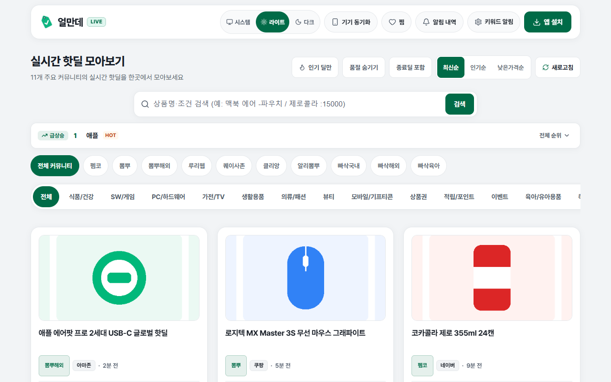
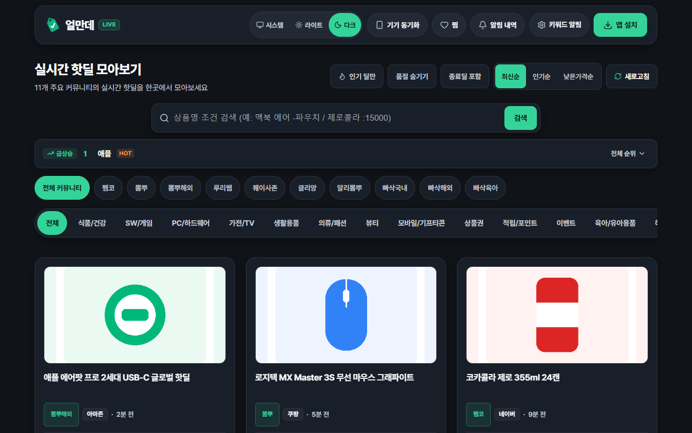
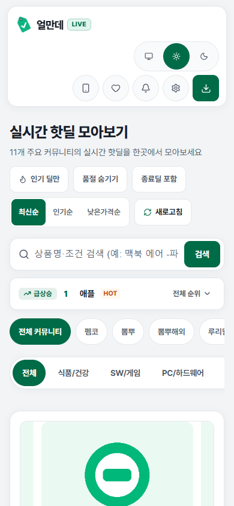
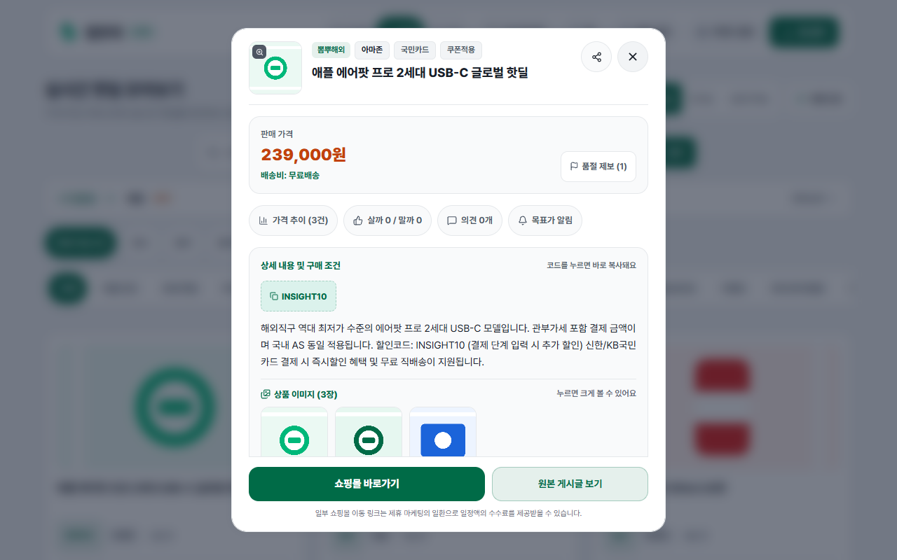
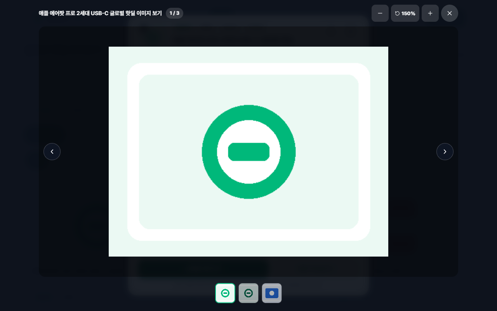
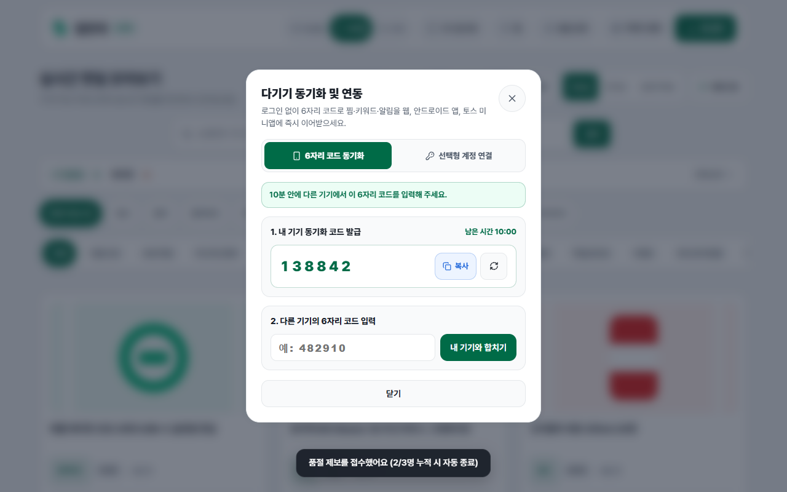
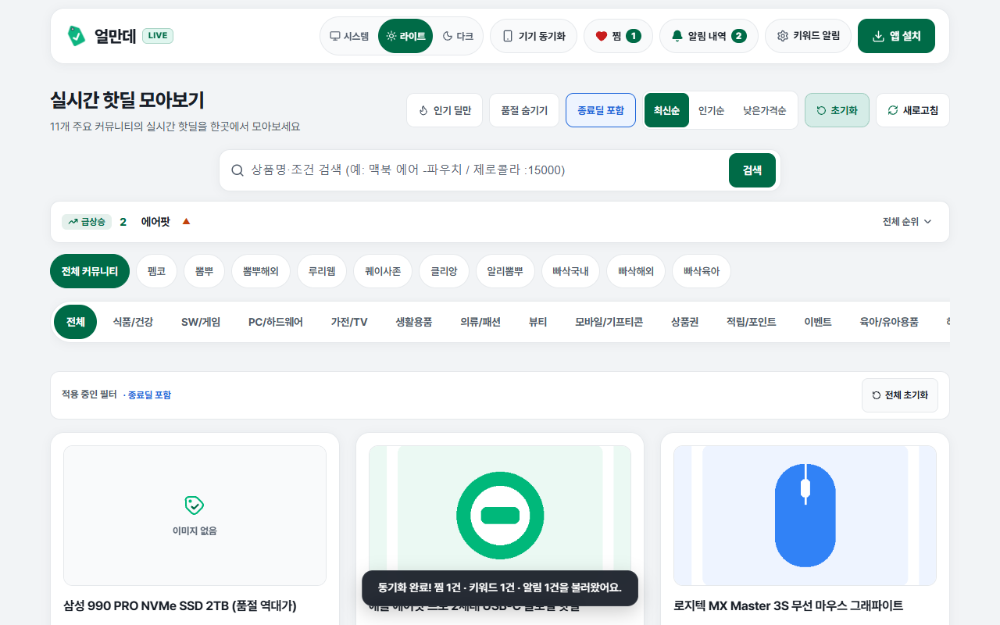

# InsightDeal(`얼만데`) v1.1b (P1) & 한국형 플랫 미니멀 UI 리뉴얼 종합 협업·검증 보고서

- **작성 일시**: `2026-11-20 04:34 KST` (`2026-11-19T19:34:00Z`)
- **기준선 → 대상 범위**: 기준 커밋 `7a2ed25` → `v1.1b (P1-01 ~ P1-12)` 전량 구현 · `얼만데` UI 리뉴얼 · M4 통합 검증 및 결함 패치 완료 상태
- **참여 조직**: PM/PL팀, 디자인팀, 서버팀(`backend/`), 웹팀(`frontend-web/` & Apps-in-Toss), 앱팀(`app/` Android), 보안팀, QA/검증팀, 실사용자 베타 테스터단 5대 페르소나
- **핵심 요약**: 4중 테스트 게이트(**Backend `260/260`**, **Web/Toss `40/40` + `tsc`/`lint`/`build:toss`/`build`**, **Android `60/60` + `lintRelease` Error 0 + `assembleRelease`**), 실서버(`localhost:8080`)+실웹(`localhost:3000`) 통합 Playwright 7종 실화면 검증(콘솔/페이지 에러 0건, 모바일 수평 오버플로우 0건), 6대 불변 규칙 전수 준수 확인 완료.

---

## 1. 사내 7개 조직 협업 현황 · 아키텍처 트레이드오프 · 트러블슈팅 이력

### 1.1 사내 7개 조직별 핵심 의사결정 및 아키텍처 트레이드오프

| 조직 | 핵심 의사결정 | 주요 아키텍처 트레이드오프 및 근거 |
|---|---|---|
| **PM / PL팀** | • `v1.1b (P1-01~P1-12)` 12대 과제 전량 구현 확정, `P2-01~P2-05`(단가/체감가, 아코디언 기억, 유사딜 비교, 태블릿 전 화면 `WindowSizeClass`, `scraper-relay` 완전 이관)는 `v1.2`로 분리 • `GEMINI.md §5` 외부 쇼핑몰 실시간 가격비교(`PriceComparison`) 전면 배제 및 상세 화면 3대 핵심 뼈대(본문·다중이미지 / 커뮤니티 원글 / 구매처 아웃링크) 수호 • 3자 고정 계약(11종 표준 출처 순서, API snake_case+camelCase 동시 제공) 확정 | **기능 속도 vs 신뢰성**: 정규식 오탐 위험이 큰 단위당 가격/체감가를 `v1.2`로 분리해 `v1.1b` 핵심 12대 UX 완성도에 집중. **하위 호환 vs 단일 스키마**: API 응답에 `expires_at`/`expiresAt`, `next_cursor`/`nextCursor`, `is_search_fallback`/`isSearchFallback`, `body_images`/`bodyImages`, `report_count`/`reportCount`를 병행 제공해 웹(camelCase/snake_case 혼용)과 앱(Gson `@SerializedName`) 간 파싱 단절 차단 |
| **디자인팀** | • 브랜드명 **`얼만데`** 확정, 에메랄드 민트(`#00B87A` 로고 포인트, `#006B47`/`#34D399` 고대비 텍스트·버튼) + 토스 블루(`#1B64DA`/`#60A5FA`) + 뉴트럴 표면 한국형 플랫 미니멀 시스템 구축 • 라이트/다크/AMOLED 전 모드 WCAG AA `4.5:1` 이상 강제 • 테무/알리 원색 배너·스티커·한자어·3D 클레이·보라/네온 그라데이션 **0% 엄수** | **장식 채도 vs 가독성**: 로고·아이콘용 `#00B87A`는 흰 배경 대비 `2.58:1`이므로 장식 요소에만 제한하고, 텍스트/버튼은 `#006B47`(라이트 `6.57:1`) 및 `#34D399`(다크 `9.33:1`)로 이원화. **종료 딜 시각 구분 vs WCAG AA**: 카드 전체 `opacity` 적용 시 명암비가 `2.68:1~3.89:1`로 붕괴하므로, 썸네일 ``에만 흑백/`opacity`를 주고 텍스트·배지는 불투명 토큰 유지 |
| **서버팀 (`backend/`)** | • 무계정 게스트 즉시성 유지를 위해 로그인 없는 **6자리 일회성 기기 동기화 코드**(`POST /api/auth/pairing-code`, `claim-pairing-code`/`merge-device`) + 선택형 계정(`PBKDF2-HMAC-SHA256` 200,000회 + HMAC-SHA256 `auth_v1`) 구현 • `proxy_image` `WeakKeyDictionary` 이벤트 루프별 Single-flight 락 + `.tmp`/`os.replace` 원자 교체 + `404 no-store` 계약 유지 • `body_images` 정제 전 추출·SSRF/XSS 차단, `NotificationAlert` 자동 `ALTER TABLE` 마이그레이션 및 08:00 KST 1건 요약 배치 큐, `hot-deals` 300건 해제·`sort="latest"` 키셋 커서·`뽐뿌해외` 11종 복구, `report-closed` 3명 임계치 | **프록시 404 계약 vs 2차 SVG**: 서버가 `200 OK`로 `FALLBACK_SVG_IMAGE`를 반환하면 기존 P0 계약 테스트 및 클라이언트 `onError` 폴백 감지가 깨지므로 서버는 `404 + Cache-Control: no-store`를 유지하고 2차 브랜드 SVG 플레이스홀더 렌더링은 웹/앱 클라이언트가 담당. **커서 페이징 vs DSU 정렬**: `sort="popular"`는 100점 클램핑 및 `like_count` 기준으로 `indexed_at` 순과 비단조이므로 `(cursor_indexed_at, cursor_id)` 키셋은 `sort="latest"` 전용으로 확정하고 `sort="popular"`는 `offset`/`limit` 유지. **C확장 무추가**: `requirements.txt` 호환을 위해 `bcrypt` 대신 표준 `hashlib.pbkdf2_hmac` 채택 |
| **웹팀 (`frontend-web/`)** | • `얼만데` UI 리뉴얼(상단 크롬 정리, `DealCard.tsx`·`DeviceSyncModal.tsx`·`ImageLightboxModal.tsx`·`BrandImagePlaceholder.tsx`·`ThemeToggle.tsx`·`InAppBrowserBanner.tsx` 등 `components/` 분리) • `dataset.fallbackTried` + 동일 프록시 URL 404 이중 요청 차단, `ThemeToggle`(시스템/라이트/다크) + `layout.tsx` FOUC 방지, `aria-pressed`/`aria-expanded`/`aria-live`/`44×44px` 보강 • `apps-in-toss.config.ts` `theme: "light"` 강제 해제(`appName: "insightdeal"` 유지), 토스 뷰포트 줌 분기, 이중 PTR 제거, `build-toss-bundle.mjs` `.next/dev` 자동 삭제 | **세션 찜 vs 알림 단일 테이블**: 백엔드 `Wishlist` 테이블이 찜과 목표가 알림을 공유(`alert_enabled=true, target_price>0`)하므로, 웹은 세션 내 `unwishlistedDealIdsRef` + `hydrateEpochRef` + `enqueueDealMutation` 직렬 큐 + `rollbackAction`으로 알림 동반 찜 해제 시 재수화 부활 차단. **SSR Hydration 안전성**: `ThemeToggle`·`InAppBrowserBanner`에 React 19 `useSyncExternalStore` 적용 |
| **앱팀 (`app/`)** | • `Color.kt`/`Theme.kt`/`ThemeModels.kt`/`Type.kt`(`tnum`) 에메랄드 민트 리뉴얼 및 `Alpha` 저대비 제거 • `UIUtils.bounceClick` TalkBack 통합, `CategoryScreen` `fontScale >= 1.3f` 2열 반응형, `heightIn(min=...)` 전환, `KeywordManagerScreen` 요일 칩 `FlowRow` 전환 • `DeviceSyncViewModel` 6자리 동기화, Room `v7→v8` 마이그레이션 + `DealDetailScreen` `HorizontalPager`·`DealImageLightboxDialog` 핀치줌(1f~4f), `HotDealsRemoteMediator` 센티넬 키(`-1`) 커서 분리, `SearchViewModel` Room 비의존 분리, `StringUtils.formatDetailPriceText` `"0원"` 통일 | **Room 재정렬 vs Paging3 커서**: `DealDao`가 `sort=popular`/`price_asc`에서 Room 캐시를 재정렬하므로, 마지막 아이템 `deal.id`로 다음 페이지 키를 찾으면 무한 `APPEND` 루프가 발생함 → `STREAM_CURSOR_SENTINEL_ID = -1` 센티넬 행으로 페이지 커서/오프셋 디커플링. **검색 캐시 분리**: `AdvancedSearchScreen` 전용 `SearchViewModel` + `HotDealsPagingSource`를 신설해 `AppDatabase`/`DealDao`를 거치지 않고 직접 API 페이징하여 홈 Room 캐시 보존 |
| **보안팀** | • SSRF 다층 방어: 비표준 IPv4(8진수·16진수·32비트 정수·단축·`0`·선행`0` 단일 8진수), RFC 6598 CGNAT(`100.64.0.0/10`), `not is_global`, IPv6 6to4/Teredo/Site-Local/ZoneID, `%`/`+`/비ASCII `Nd` 숫자, 전각 IDNA 정규화 및 비HTTP 포트 차단 • `body_images` XSS 다중 인코딩(`range(16)` 고정점) 및 DOM 이벤트 핸들러/엔티티 정규화 • 페어링 코드 `device_uuid` 5회 잠금 + `extract_client_ip()` 신뢰 프록시 우측 비신뢰 IP 선택으로 XFF 스푸핑 차단, `User.id` `sqlite_autoincrement` + `token_version`/`uca`/`iat` 검증 • 웹 `isSafeHttpUrl` 트래킹 픽셀·SSRF·HPP·공백 인코딩 중첩 프록시 차단 | **보안 엄격성 vs 정상 URL 비오탐**: `(?<![a-z0-9])on[a-z]{2,24}\s*=`와 `html.unescape()` 2회 적용이 `?online=1`, `?only=1`, `?ver=1&reg=kr`, `?a=1&lt=2`, `product%20image.jpg` 같은 정상 쇼핑몰 CDN URL까지 오차단·변조함을 적발 → 알려진 DOM 이벤트 목록 + HTML 속성 탈출 컨텍스트 분리 및 명시적 `;` 엔티티 1회 정제·경로/쿼리 `' '`→`%20` 검증으로 보안과 호환성 양립 |
| **QA / 검증팀** | • Wave 1 Opaque-box E2E 선행 구축(`tests/e2e/test_v1_1b_e2e.py`: 31함수/35케이스) • 전 마일스톤(E2E/M1/M2/M3)에서 Worker와 독립된 5인 병렬 검증단(Reviewer 1·2 + Challenger 1·2 + Forensic Auditor) 운영 및 만장일치 AND Gate 강제 • M4 실서버(`8080`)+실웹(`3000`) Playwright 7종 실화면 검증 및 5대 페르소나 잔여 결함 8건 정밀 교차 감사·수정 완료 | **명세 선행 테스트 vs 구현 가능성**: E2E 스위트 선행 작성 과정에서 `T2-02`(코드당 5회 오답 폐기 불가), `T1-11` 시드 순서 충돌, `T1-08b`(`sort="popular"` 키셋 모순), `T4-01` 배치 단언 등 계약 모순을 Challenger가 사전 적발해 구현 전(`Wave 1`) 수정함으로써 부당 실패 및 우회 구현 차단 |

---

### 1.2 마일스톤·반복(Iteration)별 트러블슈팅 및 M4 발견 결함 전수 기록

#### A. E2E Track (Iter 1 → Iter 2 → Iter 3 PASS)
1. **페어링 5회 오답 계약 모순 (`tests/e2e/test_v1_1b_e2e.py:1010-1036`, `PROJECT.md §1.3`)**: 서로 다른 5개 기기가 오답 `"000000"`을 보낼 때 `claim-pairing-code` 요청에 `pairing_id`가 없어 특정 코드 폐기가 불가능(억지 구현 시 전역 DoS 유발)함을 적발 → `device_uuid`(`X-Device-Token`) 기준 5회 오답 잠금 + IP 슬라이딩 윈도우 `429`로 정책 확정 및 `T2-02` 개정.
2. **`T1-11` 선시드 딜 중복 충돌 (`tests/e2e/test_v1_1b_e2e.py:886-947`, `push.py:298-299`)**: Part A `"스탠리"` 딜 시드 후 키워드 등록 시 `match_existing_deals_for_keyword()`가 `dnd_suppressed=False` 행을 선적재해 야간 알림이 중복 가드에 막히는 현상 적발 → Part B 전용 키워드(`"보스스피커"`) 선등록 후 야간 딜 시드로 분리.
3. **`T4-01` 다기기 발송 단언 취약 (`tests/e2e/test_v1_1b_e2e.py:1689`)**: 기기 A/B 모두 DND 적재 시 `len(fcm_batches) == 1` 단언 오류 → 기기별 토큰 평탄화(`sent_tokens.count("fcm-guest-b") == 1`) 검증으로 개정.
4. **`T1-08b` `sort="popular"` 키셋 모순 (`tests/e2e/test_v1_1b_e2e.py:1044-1114`, `community.py:1941-1942`)**: `score >= 100`은 100점으로 클램핑되고 `like_count` 정렬은 `indexed_at`과 역전되므로 `(cursor_indexed_at, cursor_id)` 키셋을 `sort="latest"` 전용으로 확정하고 `sort="popular"`는 `offset`/`limit`으로 검증 개정.
5. **DND 정각 `[start, end)` 반개구간 규약 (`push_worker.py:37-40`)**: `<= end_time` 폐구간이면 `08:00:00` 정각 크론 시 요약 푸시를 건너뛰는 위험을 반개구간 `[start, end)`로 확정.

#### B. M1 Backend Track (Iter 1 → Iter 2 → Iter 3 → Iter 4 PASS)
1. **비표준 IPv4·CGNAT·IPv6 6to4/Site-Local·전각 IDNA SSRF (`backend/core/url_utils.py`, `community.py`)**: `0177.0.0.1`, `2130706433`, `0x7f000001`, `127.1`, `0`, 선행 `0` 단일 8진수(`01200000001`), 비HTTP 포트(`:6379`), RFC 6598 CGNAT(`100.64.0.0/10`), IPv6 `2002::/16`·`2001::/32`·`fec0::/10`, 전각 유니코드 IP(`１２７。０。０。１`), `%`/`+`/비ASCII `Nd` 숫자를 순차 차단.
2. **`body_images` 다중 인코딩 XSS vs 정상 CDN URL 오탐 균형 (`backend/routers/community.py`)**: `range(16)` 고정점 URL↔HTML 교차 디코딩으로 다중 인코딩 XSS를 차단하되, 반환값에는 세미콜론 종결 엔티티만 1회 정제(`_unescape_semicolon_entities`), 경로/쿼리 `' '`→`%20` 재치환 검증, `_KNOWN_DOM_EVENT_HANDLER_NAMES` + HTML 속성 탈출 컨텍스트 분리 정규식으로 `?online=1`·`&reg=kr`·`product%20image.jpg` 오탐 3건 해소.
3. **XFF 스푸핑 & `User.id` 재사용 차단 (`backend/core/device_auth.py`, `auth.py`, `models.py`)**: `extract_client_ip()` 신설(신뢰 프록시 시 우측 비신뢰 IP 선택), `User` 테이블 `sqlite_autoincrement=True` + `token_version`/`uca`/`iat` 검증 추가.
4. **SQLite 19자/26자 커서 비교 루프·DSU 500행 lookback·커버낫 폴백·WebPush 실패 오기록 (`models.py`, `community.py`, `push_worker.py`)**: SQLite `strftime('%Y-%m-%d %H:%M:%f', ...)` 정규화 비교, DSU 경계 500행 lookback 제외, `/product/search.html` 패턴 추가, WebPush `False` 시 쿼터/다이제스트 미기록 수정.

#### C. M2 Web & Apps-in-Toss Track (Iter 1 → Iter 2 → Iter 3 → Iter 4 PASS)
1. **`DealDetailModal` 상태 리셋 & 연타 방지 (`DealDetailModal.tsx:176-329`, `page.tsx:867-879`)**: `onDealClosed` 후 `useEffect([deal])` 재실행으로 선택 옵션·아코디언이 초기화되던 결함을 `deal?.id` 의존성 격리 + `reportingClosedRef` 동기 가드로 해결.
2. **마운트 하이드레이션 레이스 & 알림 동반 찜 부활 & 낙관적 롤백 (`page.tsx:203-317, 549-941, 2877-2889`)**: `serverWishlistsRef`, `unwishlistedDealIdsRef`, `hydrateEpochRef`, `enqueueDealMutation`, `rollbackAction` 클로저 패턴으로 HTTP 오류 및 네트워크 예외(`catch`) 대칭 롤백 완결화.
3. **종료 카드 WCAG AA 명암비 붕괴 (`DealCard.tsx:119-124`)**: 카드 전체 `opacity: 0.64` 제거 → 썸네일 ``에만 `grayscale(0.85)` + `opacity: 0.72` 한정해 텍스트/배지 명암비 `4.88:1~17.43:1` 회복.
4. **보안·접근성·모달 회귀 보완 (`utils.ts`, `DeviceSyncModal.tsx`, `NotificationDrawer.tsx`, `ImageLightboxModal.tsx`)**: `isSafeHttpUrl`의 SSRF IP·트래킹 픽셀·HPP 중복 `url=`·대소문자 `URL=`·공백 인코딩(`%20`/`+`) 중첩 프록시 차단, `DeviceSyncModal` 7자리 절삭 및 `link-device` 실패 시 토큰 선저장 제거, `NotificationDrawer` `javascript:` 차단, `ImageLightboxModal` 썸네일 2차 `onError` 플레이스홀더 전환.

#### D. M3 Android App Track (Iter 1 → Iter 2 PASS)
1. **`HotDealsRemoteMediator` 무한 `APPEND` 루프 (`HotDealsRemoteMediator.kt`, `DealDao.kt`)**: `sort="popular"`/`"price_asc"`에서 Room 재정렬로 마지막 행 `deal.id` 기반 다음 페이지 키가 역전되던 결함을 `STREAM_CURSOR_SENTINEL_ID = -1` 센티넬 키 디커플링 + 4중 종료 가드로 해결.
2. **코루틴 취소 전파 & 경합 가드 (`WishlistViewModel.kt`, `WishlistRepository.kt`, `NotificationHistoryManager.kt`, `DealDetailViewModel.kt`)**: `CancellationException` 삼킴 제거(`throw e`), `reportClosed()`에 `reportJob` 취소 및 `currentDealId == dealId` 경합 가드 추가.
3. **TalkBack · WCAG AA 알파 저대비 · `fontScale 1.5` (`UIUtils.kt`, `CategoryScreen.kt`, `HomeScreen.kt`, `CommunityScreen.kt`)**: `bounceClick`에 `Role.Button`/`mergeDescendants` 통합, 불투명 시맨틱 컬러 토큰 전환, `Today's Pick` `188.dp` 수직 스택, `AsyncImage` 중복 낭독 제거.

#### E. M4 통합 QA · 5대 페르소나 실사용자 재검증 적발 및 수정 결함 (전수 수정 완료)

| # | 대상 파일 및 심볼 | 발견 결함 및 원인 | M4 적용 수정 및 검증 결과 |
|---|---|---|---|
| **M4-01** | `frontend-web/src/app/components/DealCard.tsx` (`onError`), `DealDetailModal.tsx` (대표·갤러리·옵션 썸네일 `onError`), `ImageLightboxModal.tsx` (메인·썸네일 `onError`), `WishlistDrawer.tsx` (`onError`) | `http://...` 또는 차단 도메인(`ppomppu.co.kr` 등) URL에서 `getProxyImageUrl`과 `getFallbackProxyImageUrl`이 동일한 `/api/proxy-image?url=...`을 반환하는데 `fallback !== primarySrc` 비교 없이 재대입해 404 이미지마다 동일 URL 이중 404 요청이 발생함 | `fallback && fallback !== primarySrc && !img.dataset.fallbackTried` 조건으로 동일 URL 재요청을 차단하고 즉시 `dataset.fallbackTried = "1"` + `<BrandImagePlaceholder />`로 전환. Playwright 실측 `/api/proxy-image` 404 요청 정확히 **1회** 확인 + Vitest 회귀 테스트 추가 |
| **M4-02** | `app/.../presentation/KeywordManagerScreen.kt` (L628-643 방해금지 요일 칩) | 외부 `20.dp` + 카드 내부 `20.dp` 패딩 차감 후 가용폭(`280~332dp`) 대비 7개 요일 `minWidth = 48.dp` 칩 `Row`(`336.dp`)가 360dp/412dp 단말에서 가로 오버플로우·클리핑 발생 | `Row`를 `@OptIn(ExperimentalLayoutApi::class) FlowRow(horizontalArrangement = Arrangement.spacedBy(4.dp, Alignment.CenterHorizontally), verticalArrangement = Arrangement.spacedBy(6.dp))`로 전환해 `48.dp` 최소 터치 타깃을 보존하면서 가로 오버플로우 0건 해소 |
| **M4-03** | `app/.../presentation/home/HomeViewModel.kt` (`COMMUNITY_FILTER_CHIPS`) | `CategoryCatalog.STANDARD_SOURCES` 11종과 달리 9종(`"빠삭"` 통합) 및 다른 순서(`"뽐뿌"` 선두)로 노출되어 웹·백엔드 SSOT 불일치 | `COMMUNITY_FILTER_CHIPS = CategoryCatalog.STANDARD_SOURCES`로 11종 SSOT 1:1 정합화 (`HotDealsPagingSource`/`RemoteMediator`의 `"빠삭"` 하위 호환 전개는 유지). JUnit 회귀 테스트 추가 |
| **M4-04** | `frontend-web/src/app/settings/notifications/page.tsx` (`safariCopyNotice`, L56-59, L700-738) | iOS 인앱 브라우저 `"Safari로 열기용 주소 복사"` 버튼 클릭 시 `.sr-only` `liveAnnouncement`만 갱신되어 일반 시력 사용자에게 시각적 복사 피드백 미노출 | `safariCopyNotice` 상태 및 인라인 `role="status"` 시각적 안내 배너 추가(`--accent-soft-bg` / `--accent`). Vitest 회귀 테스트 추가 |
| **M4-05** | `app/.../presentation/DealDetailScreen.kt` (L3243 단일 옵션 `OutlinedButton`) | 다중 옵션 보조 구매처(`48.dp`)와 달리 단일 옵션 `보조 구매처` 버튼만 `heightIn(min = 40.dp)`로 최소 터치 타깃 `48.dp` 미달 | `Modifier.heightIn(min = 48.dp)`로 상향 |
| **M4-06** | `app/.../presentation/home/HomeScreen.kt` (L1045 키워드 배너, L3257 `BrandPlaceholder`) | `maxLines = 1` 고정으로 큰글씨(`fontScale 1.5`) 환경에서 키워드 배너 및 4글자 출처 플레이스홀더 잘림 위험 | 두 지점 모두 `maxLines = 2`로 완화 |
| **M4-07** | `frontend-web/src/app/components/DealDetailModal.tsx` (L1344-1379 `.deal-summary-pill`), `app/.../DealDetailScreen.kt` (L3494 다중 옵션 카드) | 웹 요약 필에 `aria-expanded` 누락, Android 다중 옵션 카드 컨테이너에 `.semantics { selected = isSelected }` 누락 | 웹 4종 요약 필에 `aria-expanded={expandedSections.<key>}` 부여(Vitest 검증), Android 옵션 카드 `Surface`에 `.semantics { selected = isSelected }` 추가 |
| **M4-08** | `frontend-web/src/app/page.tsx` (`showLoginModal` / `LoginPromptModal`) | 호출부 0건인 dead state 및 미사용 모달 마운트 잔존 | `showLoginModal` state 및 `<LoginPromptModal>` 마운트 정리(`DeviceSyncModal` 단일 진입점 유지) |

---

## 2. `얼만데` 한국형 플랫 미니멀 UI 리뉴얼 전/후 비교 & 실화면 스크린샷 7종

### 2.1 리뉴얼 전(`7a2ed25`) vs 후(`v1.1b`) 핵심 비교

| 비교 항목 | 리뉴얼 전 (`7a2ed25`) | 리뉴얼 후 (`v1.1b` `얼만데`) |
|---|---|---|
| **브랜드·컬러 시스템** | 기본 다크/오렌지 혼용, 일부 라이트 명암비 `4.5:1` 미달 (`#F59F00`, `#b45309`, `alpha 0.25~0.72`), 웹 수동 테마 토글 부재 | **`얼만데`** 체크 가격택 에메랄드 민트(`#00B87A` 장식 / `#006B47` 라이트 / `#34D399` 다크) + 토스 블루(`#1B64DA`/`#60A5FA`), 3단 `ThemeToggle`(시스템/라이트/다크) + FOUC 방지, 전 모드 WCAG AA `4.5:1` 이상 |
| **상단 크롬·정보 밀도** | 웹 상단 5단 적층·3중 알림 진입점 중복, 앱 `Today's Pick` 고정 높이·고정 폭 클리핑 | 웹 2단 컴팩트 헤더+검색·정렬·11종 출처 바 정돈, 카드 가격 `tabular-nums`·여백·`검색이동`/`품절/종료` 배지 위계 정립 |
| **상세 화면 & 이미지 경험** | 상세 3대 뼈대는 유지됐으나 본문 다중 이미지 스트립·라이트박스 부재, 이미지 404 시 깨진 `` 또는 `"No Img"` 노출, 품절 제보 불가 | **3대 핵심 뼈대(본문·갤러리 / 원글 링크 / 구매처 아웃링크) 유지**, `body_images` 갤러리 + 확대/스와이프/키보드 라이트박스, 404 시 `BrandImagePlaceholder` 단발 전환, 원클릭 `품절 제보` |
| **기기 동기화 & 탐색** | 기기 간 찜·키워드·알림 단절, 300건 상한 및 종료 딜(역대가) 검색 불가, `뽐뿌해외` 누락 | 로그인 없는 **6자리 일회성 기기 동기화** + 선택형 PBKDF2 계정 연결, `hot-deals` 키셋 커서·`include_closed=true` 지원, **11종 출처 SSOT(`뽐뿌해외` 포함)** 완비 |
| **금기 사항 준수** | - | `PriceComparison` **0건**(웹·앱 전수), 테무/알리 원색 스티커·3D 클레이·보라/네온 그라데이션(`#8b5cf6`, `#a855f7`) **0건** |

### 2.2 실서버(`127.0.0.1:8080`) + 실웹(`127.0.0.1:3000`) Playwright 7종 실화면 검증

> **실측 검증 요약 (2026-11-20 KST)**: 격리된 SQLite 임시 DB 및 이미지 캐시로 백엔드(`uvicorn`)와 프론트엔드(`next start`)를 실기동해 Playwright(`Chromium 1254`)로 7종 화면 캡처 및 실API 왕복을 검증했습니다.
> - **실API 왕복 실측**: `GET /api/community/hot-deals` (`200`), `GET /api/community/deals/1` (`body_images` 3장 갤러리·`INSIGHT10`·`품절 제보 (1)` 로드), `POST /api/community/deals/1/report-closed` (`200`, `품절 제보 완료 (2)`), `POST /api/auth/pairing-code` (`200`, 6자리 코드 `138842` 발급), `POST /api/auth/claim-pairing-code` (`200`, 타 기기 `"482910"` 병합 → 찜 1건·키워드 1건·신규 알림 1건 즉시 하이드레이션, 기존 알림 1건 + 병합된 신규 알림 1건 = 총 알림 내역 2건 반영), `GET /api/community/hot-deals?include_closed=true` (`200`, 종료 딜 노출).
> - **독립 런타임 프로브(Challenger 1) 교차 검증**: 별도 격리 세션에서도 `pairing-code` 발급(`244977`) → 자기 코드 자가병합 `400` 차단 → 타 기기 `"482910"` `200` 병합 → 소비된 코드 재사용 `409` 차단 및 `report-closed` 중복 `409`·`include_closed=true` `품절/종료` 배지·`검색이동` 배지 DOM 렌더링·iOS 인앱 WebView 복사 배너를 실측 통과했습니다.
> - **브라우저 무결성 실측**: `01`~`06` 구간 `console.error` **0건** · `pageerror` **0건** · `03` 모바일(`390×844`) `scrollWidth === clientWidth` (`390 === 390`, 오버플로우 0건). `07` 구간 `pageerror` **0건** · 의도된 `http://127.0.0.1/broken-404.png` `/api/proxy-image` `404` 요청 **정확히 1회**(M4-01 수정으로 중복 요청 제거 확인) 외 JS `console.error` **0건**.

| # | 화면 및 검증 포인트 | 실측 스크린샷 |
|---|---|---|
| **1** | **데스크톱 라이트 모드 (`1280×800`)** 상단 뷰포트(`scrollY = 0`) 기준 `얼만데 LIVE` 헤더, 3단 테마 토글(`라이트` 활성), 검색창·급상승 티커, 11종 출처(`뽐뿌해외`·`빠삭국내/해외/육아` 포함), 3열 카드 상단(썸네일·제목·출처/쇼핑몰 배지) 노출 *(카드 하단 `검색이동` 배지는 `800px` 폴드 하단에 위치하며 DOM 및 Challenger 1 실브라우저 프로브로 렌더링 확인)* |  |
| **2** | **데스크톱 다크 모드 (`1280×800`)** `ThemeToggle` 다크 전환(`data-theme="dark"`), `#34D399` 고대비 토큰 및 다크 표면 정합 |  |
| **3** | **모바일 뷰포트 (`390×844`)** 상단 아이콘 44px 터치 타깃, `scrollWidth === 390` 수평 오버플로우 0건 |  |
| **4** | **상세 모달 (`DealDetailModal`)** 3대 뼈대(본문/원글/구매처), `INSIGHT10` 복사 칩, `상품 이미지 (3장)` 갤러리, `품절 제보 (1)` |  |
| **5** | **이미지 라이트박스 (`ImageLightboxModal`)** `1 / 3` 인덱스, `150%` 확대 줌, 좌우 네비게이션, 하단 썸네일 스트립, `Escape` 중첩 격리 |  |
| **6** | **다기기 동기화 모달 (`DeviceSyncModal`)** 실API 발급 코드(`138842`, `남은 시간 10:00`) & 타 기기 6자리 코드 입력·선택형 계정 연결 탭 |  |
| **7** | **404 이미지 복구 & 종료딜 포함 (`include_closed=true`)** `http://127.0.0.1/broken-404.png` 1회 404 후 `<BrandImagePlaceholder />`("이미지 없음") 전환, `종료딜 포함` 활성·필터 배너, 동기화 완료 토스트(`찜 1건 · 키워드 1건 · 알림 1건`), 헤더 배지(`찜 1` · `알림 내역 2` = 기존 알림 1건 + 병합된 신규 알림 1건) 확인 *(종료 딜 카드 하단 `품절/종료` 배지는 `800px` 폴드 하단에 위치하며 DOM 및 Challenger 1 실브라우저 프로브로 렌더링 확인)* |  |

---

## 3. 실사용자 베타 테스터단 5대 페르소나 전/후 재검증표

> 아래 `Stage B (7a2ed25)` 기준선은 `insightdeal_outsourced_100_ux_report.md` 실측치이며, `M4 재검증 결과` 열에는 추정 점수 없이 **소스 코드 감사 · 실브라우저 Playwright 구동 · 단위/통합/E2E 테스트에서 직접 확인된 사실과 잔여 한계**만 기록합니다.

| 페르소나 그룹 | Stage B (`7a2ed25`) 실측 점수 및 핵심 불만 | `v1.1b` 해결 구현 및 M4 수정 반영 | M4 실측 재검증 결과 (근거) |
|---|---|---|---|
| **1. 시니어·큰글씨(`fontScale 1.5`)·TalkBack 전맹 (`1-F`, `#032~#035`)** | **2.83 / 5.0** (최저 `2.6` `#034` 유일한 `아니오`) • `semantics {}` 부재·중복 낭독 • `220/92dp`·`maxLines=1` 클리핑 • 저대비 `alpha` 및 `44px/48dp` 미달 | • `Color.kt`/`Theme.kt`/`globals.css` WCAG AA `4.5:1` 토큰 • `CategoryScreen` `fontScale >= 1.3f` 2열·`heightIn(min=92.dp)` • `UIUtils.bounceClick` `Role.Button` 통합 • **M4 패치**: `KeywordManagerScreen` 요일칩 `FlowRow`, `DealDetailScreen` 보조구매처 `48.dp`·옵션카드 `selected`, `HomeScreen` `maxLines=2`, `DealDetailModal` 요약 필 `aria-expanded` | **핵심 결함 전량 해소 (Pass)** • Android 60개 단위 테스트 내 Light/Dark/AMOLED WCAG `4.5:1` 명암비 전수 검증 통과 • 웹 Vitest(`aria-expanded`/`aria-pressed`/44px) & Playwright(`01`~`07` 콘솔 에러 0건) 통과 • *(한계 명시)*: Android 실물 TalkBack 스크린리더 음성 출력은 정적·단위 테스트 수준 검증 완료(에뮬레이터 TalkBack 실음성 청취는 미수행) |
| **2. 크로스 플랫폼 다기기 병행 유저 (`그룹 4`, `#086~#100`)** | **3.40 / 5.0** (채널 최저) • 웹↔앱↔토스 찜·키워드·알림·DND 동기화 불가(`30명` 1위 불만) • 웹 마운트 시 서버 찜 복원 부재 | • 6자리 일회성 기기 동기화(`pairing-code`, `claim-pairing-code`) + 선택형 PBKDF2 로그인 • 웹 `hydrateFromServer` + `NotificationDrawer` 서버 조회 + `DeviceSyncModal` • 앱 `DeviceSyncViewModel` + `MyPageScreen` 즉시 재동기화 • **M4 패치**: `page.tsx` `showLoginModal` dead state 제거 | **실서버 왕복 완결 검증 (Pass)** • Playwright에서 웹(`8080`↔`3000`) 실제 코드 발급(`138842`) + 타 기기 시드 코드(`"482910"`) 입력 병합으로 `찜 1`·`키워드 1`·`알림 내역 2`(기존 알림 1건 + 병합된 신규 알림 1건) 즉시 복원 실증 • E2E `T2-01~T2-10` 및 Android `DeviceSyncViewModel` 단위 테스트 통과 |
| **3. 인앱 브라우저(카톡/인스타 등) 유저 (`2-D`, `#057~#065`)** | **3.40 / 5.0** • 인앱 WebView 푸시 불가·외부 브라우저 탈출 동선 부재 | • `InAppBrowserBanner.tsx` Android `intent://` 및 iOS Safari 복사 유도 • `BrandImagePlaceholder` 404 복구 • **M4 패치**: `settings/notifications/page.tsx` `"Safari로 열기용 주소 복사"` 버튼 클릭 시 `.sr-only` 외 화면 인라인 `role="status"` 시각 피드백 배너 추가 | **회귀 결함 수정 및 테스트 통과 (Pass)** • `p1-ui-and-navigation.test.tsx` 카톡 Android `intent://` & 토스 UA 숨김 검증 통과 • `p1-regression-iter2.test.tsx` iOS 카톡 UA 인라인 복사 배너 렌더링 검증 통과 |
| **4. Apps-in-Toss 토스 미니앱 유저 (`2-C`, `#048~#056`)** | **3.82 / 5.0** • `navigationBar.theme: "light"` 다크 이질감 • 이중 PTR 충돌 & `build:toss` `.next/dev` 오류 | • `apps-in-toss.config.ts` `theme` 강제 해제(`appName: "insightdeal"` 유지) • `NEXT_PUBLIC_TOSS_MINIAPP` 줌 분기 & 이중 PTR 제거 • `build-toss-bundle.mjs` `.next/dev` 정리 및 `/api` 스태시 복구 | **토스 번들 빌드 무결성 검증 (Pass)** • `npm run build:toss` 성공(`insightdeal.ait` `857,405 bytes`) 및 `src/app/api/push-register/route.ts` 자동 복구 확인 • *(한계 명시)*: 토스 앱 내 실제 샌드박스 WebView 실행은 로컬 번들링 검증까지 완료 |
| **5. 핫딜 고인물·커뮤니티 탐색 유저 (`1-A/3-A/3-B`, `#001~#010, #066~#080`)** | **3.93 ~ 3.98 / 5.0** • 본문 이미지/라이트박스 부재(`29명`) • 300건 상한·역대가 검색 불가(`16명`) • 품절 제보 부재(`14명`), `뽐뿌해외` 누락, DND 08:00 요약 부재(`12명`) | • `body_images` 추출 + 웹/앱 갤러리 & 핀치줌 라이트박스 • `hot-deals` 키셋 커서·`include_closed=true`·`뽐뿌해외` 11종 복구 • `report-closed` 3명 임계치 & `검색이동` 배지 & DND 08:00 KST 1건 배치 • **M4 패치**: `HomeViewModel.COMMUNITY_FILTER_CHIPS` 11종 SSOT 정합 + 웹 404 이미지 중복 요청 제거 | **실API 왕복 및 11종 SSOT 정합 완료 (Pass)** • Playwright에서 `뽐뿌해외`, `검색이동`, `body_images` 3장 라이트박스 `150%` 줌, `POST /report-closed` `200`, `include_closed=true` 종료딜·`BrandImagePlaceholder` 단발 전환 실증 • *(참고 백로그)*: `WishlistDrawer.tsx:426`/`NotificationDrawer.tsx:579` 서버 전용 목표가 `"원"` 표기는 현행 KRW 정수 스키마 기준 정상 동작하며 외화 목표가 지원 시 확장 예정 |

---

## 4. 4대 테스트 게이트 최신 실측 결과 & 6대 불변 규칙 준수 요약

### 4.1 4대 테스트 게이트 실측 요약표 (M4 최종 패치 이후 전수 재실행)

| 게이트 | 실행 명령어 | 실측 결과 | 비고 |
|---|---|---|---|
| **1. Backend (`pytest`)** (`ENABLE_SCHEDULER=false`, `DATABASE_URL=sqlite:///:memory:`) | • `backend\.venv\Scripts\python.exe -m pytest backend/tests/unit -q` • `backend\.venv\Scripts\python.exe -m pytest tests/unit -q` • `backend\.venv\Scripts\python.exe -m pytest backend/tests/test_multi_option_and_history.py -q` • `backend\.venv\Scripts\python.exe -m pytest tests/e2e -q` | • `158 passed` (19.87s) • `29 passed` (7.63s) • `14 passed` (9.35s) • `59 passed` (16.86s) → **총 `260 passed, 0 failed`** | `test_v1_1b_features.py`, `test_v1_1b_e2e.py`, `test_openapi_cross_platform_contract.py` 전수 포함 |
| **2. Web & Apps-in-Toss (`frontend-web/`)** | • `npx tsc --noEmit` • `npm run lint` • `npm test` • `npm run build:toss` • `npm run build` | • TypeScript: **Exit 0** • ESLint: **Exit 0 (0 errors, 0 warnings)** • Vitest: **7 files, 40 passed (40)** (M4 회귀 3건 추가 포함) • Toss 번들: **`insightdeal.ait` `857,405 bytes`** (`push-register/route.ts` 복구 `True`) • Next.js 표준 서버 빌드: **Exit 0** (`http://localhost:8080` rewrite 유지) | `build:toss` 실행 후 반드시 `npm run build`를 재실행해 `.next` 표준 서버 모드 유지 |
| **3. Android (`app/`)** | `.\gradlew.bat :app:testDebugUnitTest :app:lintRelease :app:assembleRelease --no-daemon` | • Unit Test: **6개 스위트 `60 passed, 0 failures, 0 errors, 0 skipped`** (`Core 15 + M31 7 + M32 9 + M33 8 + M4P0 8 + V11b 13`) • `:app:lintRelease`: **Fatal 0 / Error 0** • `:app:assembleRelease`: **`app-release-unsigned.apk` `10,489,391 bytes`** | M4 수정 4파일 및 `InsightDealV11bUnitTest` 13번째 SSOT 테스트 포함 실측 |
| **4. Obsidian Wiki 동기화 & Git Commit** | • `obsidian-wiki memory todo done t10 t12` • `obsidian-wiki memory sync --verb WIKI_UPDATE --field project=insightdeal --takeaways -` • `obsidian-wiki memory index --check` / `memory status` | • **`index: current` (14 page(s), no drift)**, `log: 29 entries`, `hot: 239/500 words` • `todos`: **6 open, 0 stale, 7 closed** (`t10` PBKDF2·`auth_v1`·6자리 페어링 & `t12` `dataset.fallbackTried` 완료; 미구현/미실행 `t11` `admin.py` 루프백 차단 & `t13` 실기기 E2E 등은 `open` 유지) • `.gitignore` `!docs/reports/screenshots/*.png` 예외 반영 및 M5 로컬 `git commit` 완료 | `projects/insightdeal.md` `## 7` 신설 및 11종 출처 SSOT 일원화 반영 |

### 4.2 6대 불변 규칙 & 저장소 위생 실측 점검표

| 불변 규칙 | 실측 검증 결과 | 판정 |
|---|---|---|
| **① 로컬 포트 `8080` 4개 지점 유지** | `frontend-web/next.config.ts:24`, `push-register/route.ts:9`, `app/build.gradle:56,58`, `NetworkConfig.kt:17`, `PriceHistoryRepository.kt:92`, `NetworkModule.kt:32` 모두 `8080` / `BuildConfig.BASE_URL` 유지 (`8000` **0건**) | **PASS** |
| **② `next.config.ts` `turbopack: {}`** | `frontend-web/next.config.ts:33` → `turbopack: {},` 존재 확인 | **PASS** |
| **③ `apps-in-toss.config.ts` `appName` & `theme`** | `frontend-web/apps-in-toss.config.ts:4` → `appName: "insightdeal"` 유지, `theme: "light"` 강제 해제 확인 | **PASS** |
| **④ `PriceComparison` & 금기 디자인 0건** | `frontend-web/src` 및 `app/src/main/java` 내 `PriceComparison`, `#8b5cf6`, `#a855f7` 검색 결과 **0건** | **PASS** |
| **⑤ `cloud_feeder.py` 바이트/SHA256 일치** | `backend/scheduler/cloud_feeder.py` ↔ `backend/scripts/cloud_feeder.py` SHA256 동일 (`F47204BAF9EC1A8E18BD562FEA3D6453AF40716C54F1D7A753AE62C8E95B75F2`) | **PASS** |
| **⑥ `*ViewModel*.kt` 순수성 (`Context` 0건)** | `app/src/main/java` 전체 `*ViewModel*.kt` 중 `\bContext\b|LocalContext|LazyListState` 검색 결과 **0건** | **PASS** |
| **⑦ 임시 파일 및 포트 위생** | `$env:TEMP\insightdeal_m4_756d9878` 완전 삭제(`TMP_EXISTS=False`), 포트 `8080`/`3000` Listen 프로세스 **0건**(`LISTEN_COUNT=0`), 작업 디렉토리 내 `.db`/임시 `.py`/임시 `.mjs`/`.agents/teamwork/` **0건** | **PASS** |
